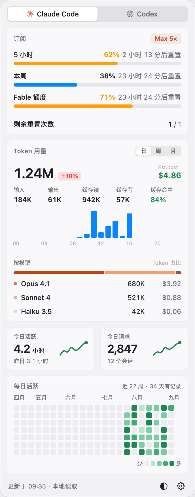
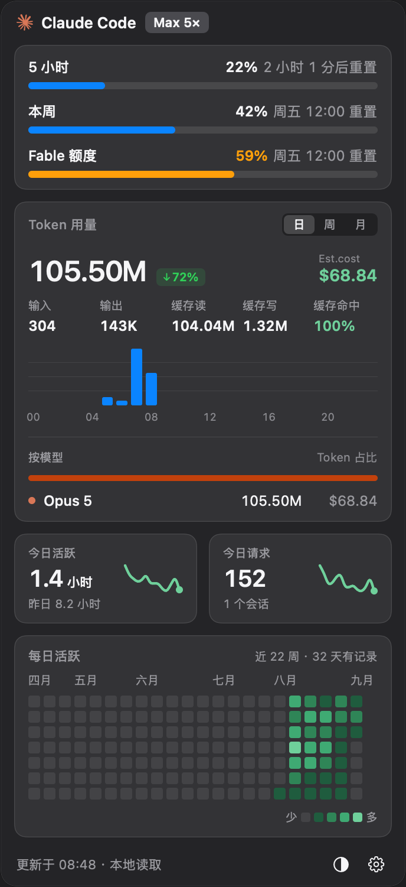
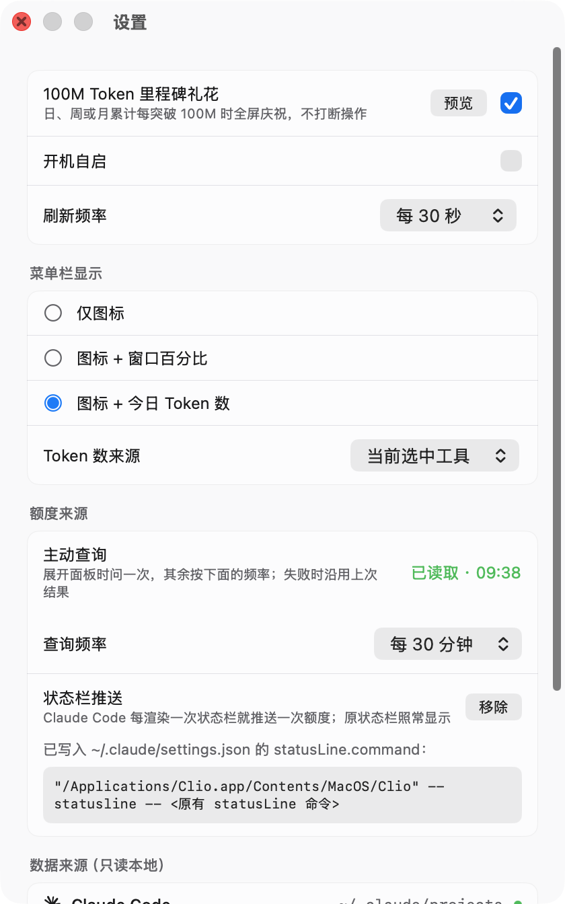

<div align="center">
  
  <h1>Clio</h1>
  <p><strong>在菜单栏，掌握编程助手的用量。</strong></p>
  <p>面向 macOS 的 Claude Code 与 Codex 用量工具<br>查看订阅额度、使用趋势、模型费用与每日活跃。</p>
  <p>
    <a href="https://github.com/UreMySunshine/clio/releases">下载应用</a> ·
    <a href="#快速开始">快速开始</a> ·
    <a href="#核心功能">核心功能</a> ·
    <a href="#从源码构建">从源码构建</a>
  </p>
  <p>macOS 14 及以上 · Apple Silicon · 本地日志统计</p>
</div>

<p align="center">
  
  
</p>

同时使用 Claude Code 与 Codex 时，额度和使用记录分散在各自的工具中。Clio 将本机已有的会话记录汇集到菜单栏：开始使用前查看额度，使用过程中观察消耗，结束后回顾当天的用量与活跃情况。

| 使用中的需求 | Clio 提供的能力 |
| --- | --- |
| 了解订阅额度与重置时间 | 并列显示两个工具的额度窗口，按利用率提示颜色 |
| 查看今天或任意日期范围的用量 | 日、周、月及自定义范围，支持合并与单工具查看 |
| 了解用量集中在哪些模型 | 模型占比、Token 数与费用估算 |
| 回顾每天的使用情况 | 今日活跃、请求数量与近 22 周热力图 |
| 随时查看，减少切换窗口 | 菜单栏常驻，直接展示今日用量或剩余额度 |

> 主面板及菜单栏截图使用示例数据；设置截图展示本机连接状态。离屏截图不包含实时桌面的玻璃折射效果。

## 名称

**Clio（克利俄）**的名称源自希腊神话中掌管历史的缪斯，寓意记录与回顾。应用将日常使用记录整理为用量历史，便于了解使用情况随时间的变化。

## 安装

**系统要求：搭载 Apple Silicon 芯片的 Mac，macOS 14 或更高版本。** 当前安装包不支持 Intel Mac。

1. 从 [GitHub Releases](https://github.com/UreMySunshine/clio/releases) 下载磁盘映像（DMG）。
2. 打开安装包，将 Clio 拖入「应用程序」。
3. 启动 Clio，点击菜单栏图标查看用量面板。

应用未做 Apple 开发者签名与公证。首次打开若被 macOS 安全机制拦截，可在「系统设置 → 隐私与安全性」中选择「仍要打开」。后续版本可在 Clio 设置的「更新」分组中下载安装。

## 快速开始

### 1. 读取本机使用记录

Clio 启动后自动读取 Claude Code 与 Codex 的本地会话日志，无需导入文件或另建用量账号。首次使用若没有数据，先在任一工具中完成一次请求，再通过面板底栏的 **齿轮 → 刷新** 重新读取。

应用常驻菜单栏，不显示程序坞图标。订阅额度显示在面板顶部，下方依次展示用量、今日活跃、模型明细与历史活跃。

### 2. 选择查看范围与周期

点击底栏的用量图标，依次切换 **合并 → Claude → Codex**。用量、活跃度、模型明细与热力图随范围切换；顶部订阅额度和菜单栏始终展示两个工具的数据。只有一个工具有记录时，用量范围按钮隐藏。

在 Token 用量标题右侧选择 **日、周、月或自定义**。自定义日历支持年份和月份快速选择、跨月及跨年范围；点击第一次选择起始日期，第二次选择终止日期，点击「应用」生效。「取消」或关闭浮层保留原来已生效的范围。已选择的自定义范围会保存，点击「自定义」可重新打开。

日历顶部的 **近7天、近30天** 包含今天，点击后立即应用。日期范围只影响 Token 用量和模型明细；今日活跃、今日请求和历史热力图保持各自的时间范围。悬停总量、分项数值或柱状图，可查看对应工具或时段的详细数据。

### 3. 设置菜单栏与外观

通过 **齿轮 → 设置…** 打开设置。在「菜单栏与外观」中选择常驻显示内容及跟随系统、浅色或深色外观，也可在底栏切换外观。在「通用」中调整刷新频率、开机自启和里程碑礼花。

## 核心功能

### 订阅额度：查看消耗与重置时间

额度卡片按 Claude Code、Codex 的顺序显示工具名称、套餐和额度窗口。窗口包括 **5 小时、本周及按模型划分的额度**，具体内容取决于工具提供的数据。

Codex 卡片同时显示剩余手动重置次数。次数为 0 时显示「0 次」，接口未提供次数或查询失败时显示「未知」。

百分比和进度条表示已使用额度，右侧显示距重置的时间。利用率达到 **60%** 时显示橙色，达到 **80%** 时显示红色。悬停进度条可查看按当前速率推算的耗尽时间；预计在重置前不会耗尽时，提示会直接说明。

Claude Code 的 5 小时窗口重置后，无新用量时显示 0%；尚未收到新的百分比时，先显示可统计的窗口内 Token 数。额度来源与更新频率见下方「统计与数据说明」。

### 用量分析：从总量查看趋势与模型分布

用量卡片展示所选周期的 Token 总量、相对上一周期的变化和费用估算，并列出输入、输出、缓存读、缓存写与缓存命中率。

| 统计周期 | 时间范围 | 趋势图分组 |
| --- | --- | --- |
| 今日 | 本地时间当天 | 小时 |
| 本周 | 从本周一开始 | 星期 |
| 本月 | 当前自然月 | 日期 |
| 近7天 / 近30天 | 包含今天的最近 7 / 30 个自然日 | 日期 |
| 自定义 | 选定的本地自然日期，包含首尾两天 | 单日按小时，多日按日期 |

自定义范围隐藏趋势百分比，标题下方显示已生效的日期。总量保留原有单位和精度，整数部分使用千位分隔符。

合并范围的趋势图按工具堆叠，Claude Code 为橙色，Codex 为蓝色。悬停柱状图可查看对应时段的数值。

模型明细默认列出前 5 个模型的 Token 数与估算费用，超过 5 个时可通过“展开全部”查看完整列表，再点击“收起”恢复。右上角可切换按 **Token / 花费** 排序，占比条始终展示完整模型分布，并随排序切换；模型颜色在周期和排序切换时保持一致。

`Est.cost` 按 [models.dev](https://models.dev) 的 Anthropic、OpenAI、DeepSeek 原厂对应型号单价估算，以美元显示，不代表订阅或网关实际账单。模型去除网关前缀后匹配原厂价格，型号与版本分别计价，仅采用原厂目录明确提供的型号对应关系；未按历史时间或高峰时段调整。缺少价格或 Token 分项时显示 `-`，Token 用量正常统计；汇总包含未定价用量时显示可估价部分的小计，并在金额提示中注明未计入的范围；全部无法定价时显示 `-`。价格表每 24 小时检查一次，新增原厂目录时立即重新获取，网络校验失败时沿用上次结果。模型主列表合并相同型号，仅在名称实际截断时悬浮显示完整规范化名称。

<details>
<summary>查看 Claude Code 与 Codex 的单工具面板</summary>

<p align="center">
  
  
</p>

左侧为 Claude Code，右侧为 Codex。底栏显示当前工具图标，订阅卡片保留两个工具的额度。

</details>

### 活跃记录：回顾当天与长期使用情况

**今日活跃**显示根据回复时间估算的活跃时长，附昨日数值；**今日请求**显示当天回复条数和去重后的会话数。两张卡片各带最近 14 天的趋势线。

**历史活跃**热力图覆盖近 22 周，颜色深浅表示每日 Token 用量。悬停日期格可查看当天数据；合并范围下，可分别查看两个工具的数值。

今日卡片与历史活跃随工具范围切换，保持各自的时间范围，不受用量卡片的周期选择影响。

### 菜单栏：随时查看今日用量与剩余额度

<p align="center"></p>

菜单栏始终统计两个工具的数据。在「设置 → 菜单栏与外观」中可选择以下显示方式：

| 显示方式 | 常驻信息 |
| --- | --- |
| 仅图标 | Clio 图标 |
| 图标 + 今日 Token 数 | 两个工具合计的今日用量 |
| 双环 + 百分比 | 两个工具各自的剩余额度，优先显示 5 小时窗口 |
| 双环 + Token（合并显示） | 额度双环与合计的今日用量 |
| 双环 + Token（分开显示） | 额度双环与各工具的今日用量 |

双环的**外圈为 Claude Code，内圈为 Codex**，数字按相同顺序排列。每个工具优先显示有百分比的 5 小时剩余额度，否则显示周剩余额度。双环与百分比文字按显示的剩余额度每 25% 一档变色：76%～100% 为白色（浅色外观为黑色），51%～75% 为黄色，26%～50% 为橙色，0%～25% 为红色；未获取到额度时显示「—」。悬停优先显示环对应的额度窗口，并列出 5 小时和每周额度及各自的重置时间。

<details>
<summary>查看双环的额度与用量显示方式</summary>

<p align="center"></p>

上下两行为浅色与深色外观。每行依次展示选中状态、常规余量、低余量、额度缺失、Token 合并显示和分开显示。

</details>

### 设置：连接方式、外观与更新

- **数据连接**：查看读取状态，调整 Claude Code 额度查询频率、接入状态栏推送，以及管理 CodexHelper。
- **菜单栏与外观**：选择菜单栏信息及跟随系统、浅色或深色外观。macOS 26 及以上使用液态玻璃呈现窗口。
- **通用**：调整本地数据刷新频率、开机自启和礼花。开机自启以系统注册结果为准。
- **更新**：检查应用版本与价格表，设置自动检查和自动安装。

自动更新在启动时及每 24 小时检查 GitHub Releases。启用自动安装后，应用在后台下载新版本，待面板与设置窗口均关闭时安装并重启。关闭自动安装后可手动安装；关闭自动检查后同时停止自动安装。应用所在目录不可写时，不执行自动安装。

<details>
<summary>查看设置界面</summary>

<p align="center">
  
  
</p>

</details>

### 里程碑礼花：记录累计用量

两个工具当天合计的用量每达到 **100M、200M、300M Token** 等档位，Clio 展示约 5 秒的全屏礼花，每个档位当天只触发一次。礼花不阻挡鼠标操作，可在「设置 → 通用」中预览或关闭。

<details>
<summary>查看里程碑礼花效果</summary>

<p align="center"></p>

</details>

## 数据连接

### Claude Code 额度同步

Clio 默认读取 Claude Code 本地额度缓存，并通过已登录的 Claude Code 主动查询。打开面板时查询一次，后台默认每 30 分钟查询一次，可在设置中调整频率。查询不消耗 Token，也不生成新会话记录。

如需在使用 Claude Code 时同步额度，可在设置中选择 **状态栏推送 → 接入**。Clio 会备份配置并保留原有状态栏命令，此后随状态栏刷新接收额度；点击「移除」可还原配置。此通道不提供按模型划分的额度。

### Codex 额度同步

Clio 读取本机 Codex 日志中的额度快照，按「本地数据刷新频率」更新，默认每 30 秒一次；同时调用本机 Codex，复用其 ChatGPT 登录状态查询额度、重置时间和剩余手动重置次数。打开面板时查询一次，后台按「通用 → 额度查询频率」更新，默认每 30 分钟一次，此频率与 Claude Code 共用。联网查询不生成模型请求或新会话；登录和凭据续期由 Codex 处理。接口与日志采用较新的完整额度快照，超过两个查询周期的快照不再使用。查询失败且没有有效快照时，额度显示「未知」；重置次数仅通过接口获取，查询失败时显示「未知」。Token 用量、费用和模型统计仍读取本机会话日志。

Claude Code 的同一重置窗口内，延迟报告不会降低已显示的使用率；新窗口可以从零开始。Codex 按快照时间更新使用率，同一窗口内的新快照也可降低使用率，不依赖剩余重置次数。Claude Code 状态栏未提供的模型额度由有效缓存补充。

「额度查询频率」下显示两个工具最近一轮联网查询的开始时间。两种查询并行执行，结果分别更新；正在进行的查询不会重复发起。

### CodexHelper：可选的本机连接辅助服务

CodexHelper 通过正在运行的本机代理转发 Codex 后台连接。它可在设置中安装；Codex 用量统计读取会话日志，额度结合日志快照与本机已登录的 Codex 查询结果。

| 服务状态 | 设置中的操作 |
| --- | --- |
| 未安装 | 安装 |
| 已安装且正常运行 | 移除 |
| 已安装，但配置不完整或服务未运行 | 修复、移除 |
| 内置辅助程序版本更高，或存在可迁移的旧式服务 | 更新、移除 |

安装、修复、更新与移除会显示执行进度和结果。更新按辅助程序独立版本判断，同版本重新构建 Clio 不会提示更新。

使用前需启用可用的本机 HTTP 与 SOCKS5 代理，具备系统 Python，并确保本机 443 端口可用。安装需要管理员授权，会备份并修改 Codex 代理配置与系统域名映射，注册开机运行的后台服务；域名映射对同机访问该域名的其他程序也生效。

服务仅监听本机地址，向固定的 Codex 后台域名转发加密连接，不读取登录凭据。安装完成后，重新启动 Codex 并检查工作空间能否加载。移除时停止服务、删除受管理的域名映射，并恢复由 Clio 修改的代理配置，保留用户后来修改的配置。操作失败时尝试恢复本次修改，恢复失败的项目会显示在结果中。

## 统计与数据说明

| 数据 | 来源与边界 |
| --- | --- |
| 订阅额度 | 工具提供的额度快照。百分比与本地 Token 累计分别统计，不能相互换算；菜单栏显示剩余额度，面板进度条显示已使用额度 |
| Token 用量 | 本机会话日志与保存的每日总量，包含压缩与归档记录，并对重复记录去重；不包含其他设备。原始日志缺失时可恢复每日总量，成本、分项、模型及小时明细显示为不可用 |
| 历史热力图与环比 | Clio 保存的每日 Token 总量，兼容既有每日记录文件；Claude Code 的统计缓存补充缺失历史。每日记录不包含模型明细与费用 |
| Codex 额度刷新 | 日志随本地数据刷新，联网查询在打开面板时及后台定期执行；未提供的短期窗口不展示，无有效快照时显示「未知」。套餐标识 `pro` 显示为「Pro 20×」，`prolite` 显示为「Pro 5×」 |
| 费用估算 | 按公开调用单价估算，未知模型按 0 计入，可能低于实际费用；原始日志缺失时显示「—」 |
| 活跃时长 | 按相邻回复的间隔累计，每段最多计 5 分钟；合并范围中重叠时间只计一次，不等同于实际工作时长 |
| Codex 用量分项 | 缓存包含在输入中，推理包含在输出中，不重复计入总量；日志报告的总量可能与可用分项之和不同 |

Clio 读取 `~/.claude/projects`、`~/.codex/sessions` 与 `~/.codex/archived_sessions`，不修改会话日志，不将用量数据上传到服务器。每日 Token 总量保存在 `~/Library/Application Support/Clio`，用于历史热力图和环比；近期有日志的日期重新计算，超过源日志清理周期的日期保留已保存总量。删除日志不会删除已保存的日期，但模型、费用和活跃度明细仍依赖现存日志。

价格表查询连接 models.dev，应用更新查询与下载连接 GitHub，额度查询由本机 Claude Code 与 Codex 执行。状态栏推送接入与 CodexHelper 管理由设置中的操作触发，会修改相应配置。

## 从源码构建

需要 Apple Silicon Mac 和 Apple Command Line Tools。构建脚本直接调用 Swift 编译器，生成应用包及原生 CodexHelper。

```bash
bash Scripts/build.sh
open build/Clio.app
```

生成安装包使用 `bash Scripts/package.sh`。签名、公证、回归测试和截图生成方式见 [开发说明](docs/development.md)。
